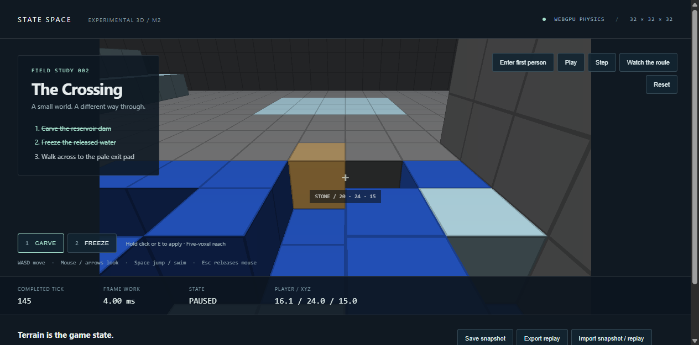

# 3D milestone 2: GPU terrain and a playable crossing

M2 adds a WebGPU backend for the unchanged `ca-3d-m1` physics, GPU-resident
exposed-face rendering, and a first-person water/freezing integration example.
The CPU reference, snapshot schema 1, catalog identity, 32,768-cell bound and
27-pass movement/thermal schedule remain unchanged. The shipped 2D engine has
no runtime changes.

## State and submission contract

The new `state-space-engine/experimental/3d/gpu` entry exports
`createGpuField3D(width,height,depth,fillMaterial?)`. It supports the same nine
materials and geometry as M1. Integer-only WGSL mirrors thermal thresholds,
latent intervals, overflow-safe heat exchange, density/buoyancy comparisons,
pair ownership, tick-dependent directions and u32 tie-breaking. Absolute ticks
remain JavaScript safe integers; the lateral hash deliberately uses low32 bits.

Each physics invocation writes only its own output cell by finding its disjoint
pair and gathering the selected input. Inputs are immutable within a pass;
dispatch order is the CPU schedule. Two private resident coordinate pairs
alternate after every pass. Rendering cannot access a writable public buffer.

All GPU field methods are asynchronous except resource cleanup. Await each
operation; overlapping access rejects. Dimensions, backend metadata and tick are
read-only. Full snapshots and samples use explicit readback and validation;
snapshots are interchangeable with the CPU field. Restore validates everything
before upload and establishes a fresh external-energy baseline.

`step(ticks,{edits,region})` validates all options before submitting. A batch
contains at most 64 distinct cells, using placement or direct energy edits.
The sparse edit kernel records old/new energies for exact host BigInt accounting.
The batch is applied once, before the first physics tick; `step(0,...)` supports
edits without stepping. Optional region output is a packed-cell copy with origin,
shape and completed tick, bounded to 4,096 cells. Returned arrays are isolated.

Normal gameplay reads a 16³ neighborhood (16 KiB) and up to 512 bytes of edit
accounting, never the full volume. The GPU compacts visible face IDs into a
bounded `6 * cellCount` array, then draws six vertices per exposed face using
indirect arguments. State, face IDs and draw arguments stay on the GPU.

## Gameplay contract

The [Crossing example](../../examples/first-person/README.md) owns version
`volume-crossing-1`. A finite water reservoir sits behind an editable dam. The
player carves a hole, removes energy from water, walks over newly solid ice,
and reaches the opposite shore. The scripted demonstration issues the same
commands as a human; it does not place water or ice during the route.

The controller uses Q=256 fixed-point XYZ positions, integer vertical velocity,
X/Z then Y swept AABB collision and binary search for the last free subcell.
Solids, powder and frozen cells collide. Water permits passage, slower movement
and jump-driven swimming; these are client rules, not added physical forces.
Targeting samples a quantized ray at 1/32-cell increments, stopping at the first
non-air/non-steam surface within five cells. Carving/cooling brushes have radius
one in each axis. Newly occupying terrain resolves upward in fixed order or
reports trapping. Characters do not push the simulation or exchange momentum.

Commands include absolute tick, quantized X/Z motion and look vector, jump and
tool. The look vector is recorded after presentation trigonometry, so replay
never recalculates platform-dependent camera trig. A gameplay tick applies tools,
steps physics, obtains committed collision state, then advances the actor.
Snapshots contain complete field/player/look/status/event state; replays contain
an initial snapshot and canonical commands. Invalid input preserves live state.

There is one active frame and at most one pending display timestamp. The frame
clock drops unserved wall time, never absolute physics ticks. Errors pause.
Reset can rebuild the device; explicit snapshots remain the recovery boundary
for device loss. There is no claim that unexported state survives a lost GPU.

## Reproduction and evidence

```powershell
npm ci
npm run build:sdk
npm test
npm run lint
npm run typecheck
npm run verify:3d:m2
uv run python -m scripts.verify_volume_m2_browser --browser-cli <agent-browser-cli> --frames
```

The Node reference checks the three M1 scenes through 1,024 ticks and retains
complete checkpoints. It independently records the 600-tick crossing, repeats
the input tape, and resumes from ticks 3,119,157,509. Browser conformance compares
complete states, exercises every pass in odd/single-axis worlds, high absolute
ticks, edits, accounting, rejected operations, bounded reads and presentation
isolation, plus the full gameplay and restart paths.

The full-frame benchmark uses 60 warmup frames then resets to tick zero for 600
measured display-paced frames at 1920×1080. Every frame includes input, edits,
all physics passes, collision readback and movement, HUD, GPU face compaction,
uploads, draw, validation and GPU completion. Snapshots, hashing, CPU replay,
warmup reset and OS scanout are excluded. Raw samples distinguish work duration
from callback-to-GPU completion, and report deadline misses, display slots,
coalescing and achieved cadence. Active crossing frames are reported separately.
Correctness and the strict 60 Hz timing gate are separate report fields.

## Recorded results

**Correctness and the strict 60 Hz gameplay gate pass.** All 675 individual
pass comparisons match both complete CPU coordinates across odd, rectangular
and single-axis worlds at ticks 0,1,3,2³²+1 and near the safe-integer limit.
Each M1 scene matches through tick 1,024, including independent GPU restarts
from ticks 3 and 509. Gameplay matches the independent Node run for all 600
commands, complete final terrain, player and events; restarts at 3,119,157,509
are exact. The route wins at tick 187 and includes walking on real frozen water.

The 68 engine Vitest tests and 17 Node rendering/controller tests pass, along
with lint and TypeScript checks. This includes existing native GPU/CPU
conformance (4,416 pass comparisons). Real installed SDK clients pass 69 pass
deltas and both TypeScript compilers. A separate outside-checkout consumer
imports the new CPU/GPU package subpaths and compiles public types without
requiring native WebGPU global declarations. The public declaration boundary
contains no writable GPU handles.

Invalid field edits, snapshots and game imports preserve state. Bounded reads
are isolated; concurrent field operations reject. Camera/rendering cannot
change material state. File-input import, complete replay round trips, invalid
input tapes, pause after an injected frame failure, rebuilding the device on
Reset, and retaining a cancelled measurement were also exercised. The failure
test injects a software exception; it does not induce a hardware device crash.

The timing run was separate from CPU replay and browser conformance, in a fresh
browser session. Recorded hardware is an Intel i9-11900K and NVIDIA RTX 4090,
driver 595.79, using hardware-accelerated Headless Chrome 155. The pre-run
inventory recorded 7% CPU and 6% GPU utilization, with
no FFmpeg processes. Background applications were not terminated. Browser and
adapter details are retained with the raw receipt.

| Complete gameplay measurement | Result |
| --- | ---: |
| Resolution / volume | 1920×1080 / 32³ |
| Warmup / measured frames | 60 / 600 |
| Median / p95 frame work | 5.6 / 7.0 ms |
| Median / p95 callback → GPU completion | 5.8 / 7.2 ms |
| Worst callback → GPU completion | 10.2 ms |
| Median / p95 physics + query + controller | 1.3 / 1.7 ms |
| Median / p95 rendering + HUD | 4.2 / 5.4 ms |
| Completed physics cadence | 59.96 Hz |
| Display callback cadence | 59.95 Hz |
| Missed 16.67 ms deadlines | **0 / 600** |
| Lost display slots / coalesced callbacks | **0 / 0** |
| Active crossing interval | 187 frames; p95 7.1 ms; zero misses |
| Exact CPU replay / energy drift | **Pass / 0 Q** |

The remaining measured frames continue running the complete field, controller,
collision query and render after the crossing is won. Warmup resets before
measurement, so the carve and freeze operations are included. External edits
remove 769,637 Q; final energy is 169,424,283 Q from an initial 170,193,920 Q.
Thermal/latent/chemical accounting remains exact; momentum and mechanical energy
are outside the model.

Retained evidence:

- [Fresh Node reference, commands and full checkpoints](volume-m2/node.json).
- [Final hardware GPU conformance and replay](volume-m2/browser-final/report.json),
  [progress](volume-m2/browser-final/progress.jsonl).
- [Full-frame receipt and all raw samples](volume-m2/frames/report.json),
  [timing progress](volume-m2/frames/progress.jsonl).
- [Before](volume-m2/host-before.json) and [after](volume-m2/host-after.json)
  hardware inventories.
- [Installed SDK checks](volume-m2/sdk.json) and
  [installed 3D subpaths/public declarations](volume-m2/installed-3d.json).
- [File import, replay, cancellation and error recovery](volume-m2/ui.json).
- [Checks and final source/artifact bindings](volume-m2/final-bindings.json).

The stable 2D bundle remains SHA-256
`0862c671ccb7d051697b47bd62760e36e04402b232035006f8935744d790a4eb`.
The M1 CPU bundle also remains byte-identical:
`2197e756308d050a7507bdcdb7614c9a7666c8ef89a425928dd4e96b148b712c`.

This result covers one bounded level on the recorded hardware, using directional
voxel shading and opaque water. It does not establish 60 Hz on other devices,
larger volumes, chunked worlds, or the earlier 2D effects stack. Pressure,
structural motion and character forces remain future work.


