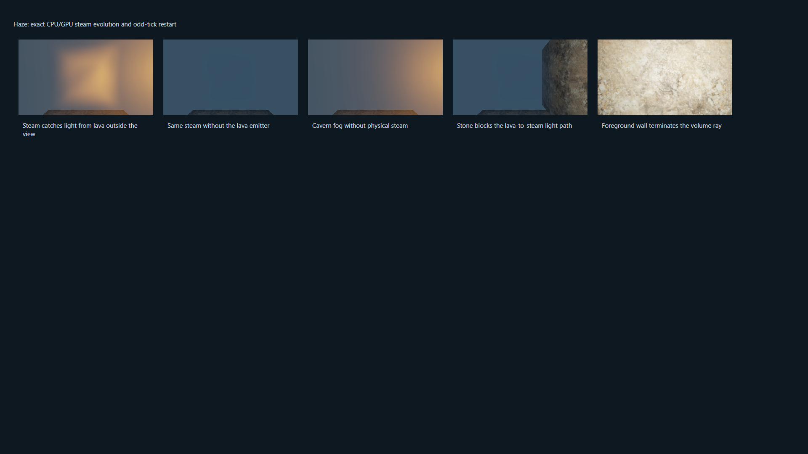
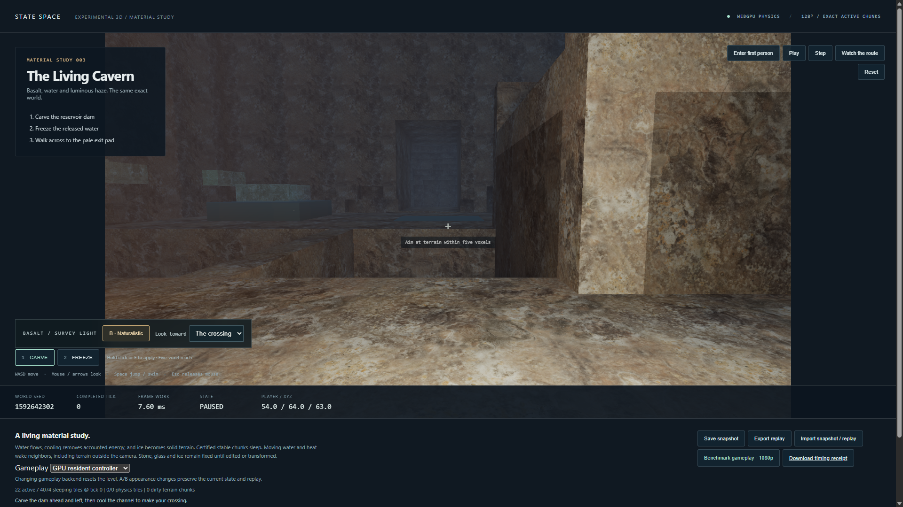

# Native volumetric steam and cavern fog

October 15, 2026. Presentation identity `cavern-haze-1`, extending the naturalistic
rock and water/ice work on `codex/cavern-materials`. Physical rules, material
catalog, seeded world, controller and replay format are unchanged. Legacy demos
remain quarantined and the incident safety hold remains active.

## Rendering contract

Naturalistic steam reads the committed `MAT.STEAM` cells as a trilinearly smoothed
density field. Low-density cavern fog is an artistic atmosphere in air and steam,
not another physical material. Steam's old little cubes are discarded from the
naturalistic surface pass so they cannot block surface depth. Diagnostic mode
keeps its original markers and colors; the A/B switch changes presentation only.

The native WebGPU pass runs at ceil(width/4) by ceil(height/4). It reconstructs
camera rays from the same-tick camera and terrain depth, then integrates 32
midpoint samples up to the nearest surface or 48 voxel units. Beer-Lambert
extinction and single scattering produce HDR radiance and transmittance. Fog is
sampled only in air/steam; opaque terrain, water and ice stop primary rays.

Each view ray selects its two strongest nearby sources from the existing light
buffer (one exposed hot lava/molten-glass cell per storage chunk). Their range is
22 cells. Grid traversal shadows, bounded at 48 crossings per source/sample,
stop light at opaque terrain. A cool ambient term fills unlit haze. The camera's
survey lamp continues to light surfaces; it does not add a volumetric source.
Depth-aware four-tap upsampling avoids carrying background haze across foreground
edges. An unmatched thin foreground pixel uses clear transmittance. Haze is
composited before the existing HDR tone map and surface bloom.

Visual density modulation follows the completed tick, sharing the water optical
uniform and its 36,000-tick period. There is no temporal history or wall-clock
randomness. Pausing and restoring a physical snapshot reproduce the image on the
tested backend. Rasterization remains presentation, not a cross-device bitwise
image contract. Physics retains its exact integer contract.

At 1920×1080 the extra rgba16float scattering/transmittance and r32float depth
targets occupy about 1.48 MiB. The existing terrain depth becomes shader-readable.
Bindings rebuild when the depth texture identity changes, including resizing in
diagnostic mode and switching back. Both new targets are destroyed on resize or
close. The profiler remains bounded to three staging slots and 32 retained
records; its fixed query capacity increases from eight to ten passes to include
`volumetrics`. Normal gameplay still uses one submission and one completion,
with no added physical state readback or simulation pass.

This is bounded approximate light transport. Quarter resolution and fixed
steps soften thin steam and small silhouettes. The nearest two selected sources
can change at light-selection boundaries. Multiple scattering, steam
self-shadowing, shadow absorption through water/ice, volumetric reflections and
caustics are deferred. Secondary water/ice rays keep their earlier distance-fog
approximation. Voxel geometry, thermal transport and gas movement are unchanged.

## Verification

Receipts, source hashes, all attempts and raw samples are indexed by
[`cavern-haze/manifest.json`](cavern-haze/manifest.json).

- Bounded CPU suites: 61 engine and 18 controller/rendering tests. The added
  profiler regression admits ten passes and rejects overflow before query writes.
- Eighteen isolated supervisor tests pass. The 128³ appearance replay now requires
  a passing, source-current haze probe as well as the material and optics probes.
- Tiny kernel cases retain complete CPU/dense/sparse equivalence, odd and
  single-cell dimensions, mesh-oracle equality and isolated readbacks.
- A 16³ haze fixture proves an offscreen lava source lights steam, replacing
  steam with air reduces scattering, and a stone blocker removes its warm light.
  A foreground wall makes images identical with and without steam behind it.
- Paused pixels, snapshot image continuation, camera/A-B state isolation, odd
  canvas sizes and diagnostic-mode depth-texture replacement pass. Twelve steam
  evolution ticks match the complete CPU state, including an odd-tick restart;
  energy drift is zero. Existing rock/lighting and water/ice controls still pass.
- Full 128³ replay from 3→31 and 509→600 alternates appearance each tick and
  matches complete retained CPU game/field snapshots, with one queue submission
  and one completion boundary per gameplay frame. Same-tick step/present images
  agree. Rendering never chooses physical work.

The unchanged CPU oracle is retained in
[`volume-m4/reference`](volume-m4/reference/node-original.json). The benchmark
compares the entire initial and final game/field snapshots and 600-command tape,
not just counts or digests. No legacy demo trajectory or aggregate release suite
ran. Build, lint, type checking and UI receipts are archived separately.

## Full gameplay frame

RTX 4090 (driver 595.79), i9-11900K, Windows 11 Home 10.0.26300,
hardware WebGPU in HeadlessChrome 155.0.0.0. Configuration: 128³, 1920×1080,
resident GPU gameplay, all naturalistic effects enabled, 60 warmup frames and
600 measured display-paced frames.

| Metric | Untraced acceptance run |
| --- | ---: |
| Actual simulation rate | 59.94 Hz |
| Full-frame median | 6.7 ms |
| Full-frame p95 | 8.2 ms |
| Full-frame p99 | 8.9 ms |
| Worst frame | 10.0 ms |
| Missed 60 Hz deadlines | 0 |
| Lost display slots | 0 |
| Energy drift | 0 |

The strict 60 Hz gate passes. The earlier sub-8 ms p95 target is not met by this
configuration. The separate timestamp run measures the volume pass at about
0.13 ms p95 on this route. Browser timestamps are quantized (roughly 0.066 ms),
so zero values in very short stages are not evidence of zero work. All 600
samples, warmup samples and the diagnostic timing breakdown are retained in
[`summary.json`](cavern-haze/summary.json) and the indexed raw receipts.

Timing includes exact physics, commands/tools, collision/controller, mesh,
lighting, rock/water/ice shading, optics, volumetrics, HDR/bloom, compact readback,
HUD, validation and GPU completion. Setup, texture loading, shader compilation,
snapshot serialization/hashing and OS scanout are excluded. This is a scripted
route measurement on one machine, not an arbitrary-camera/world or input-to-photon
guarantee. The separate timestamp run is diagnostic; stage percentiles must not
be summed.

Initial complete-state digest:
`5694fed11bf10fd458bcf74191d5592f3ef45773e87a090c8c9f3f97a06faeea`.
Final complete-state digest:
`506105f11ef608ead0ab8bb83c2b9a90f07c7a7941849a807f11b93da9cdc7da`.

## Safe reproduction and attempts

Use `python -m scripts.recover_m4_verification <stage> --browser-cli <installed-cli>`
one stage at a time. After CPU/build prerequisites: `probe`, `appearance-probe`,
`optics-probe`, `haze-probe`, `appearance-replay`, `appearance-ui`, `frames128beauty`
and optional `appearance-timing`. Inspect each receipt before advancing. Source
freshness includes the haze shader. Process-tree containment, exclusive lease,
preflight resource limits, progress timeouts and responsiveness budgets remain
unchanged. The incident hold remains active between permitted stages.

The first material probe rejected a WGSL reserved parameter name during shader
compilation. It was renamed before any large run. Failed and intermediate runs
remain archived; no limit or acceptance threshold was relaxed.

A first full-frame attempt met the timing and exact-state checks but was rejected
by its source-integrity check: a UI text-encoding correction landed while it was
running. That receipt is retained as failed, not acceptance evidence. The final
unchanged-source rerun passes all checks. Captures were regenerated afterward. Final source-bound probes and frame receipts
were refreshed after restoring the repository's original line endings; both
valid untraced runs meet the strict gate (8.1 and 8.2 ms p95).

## Captures

The controlled haze comparison isolates steam, fog, lava light and occlusion:

The unchanged cavern with the complete naturalistic appearance:

