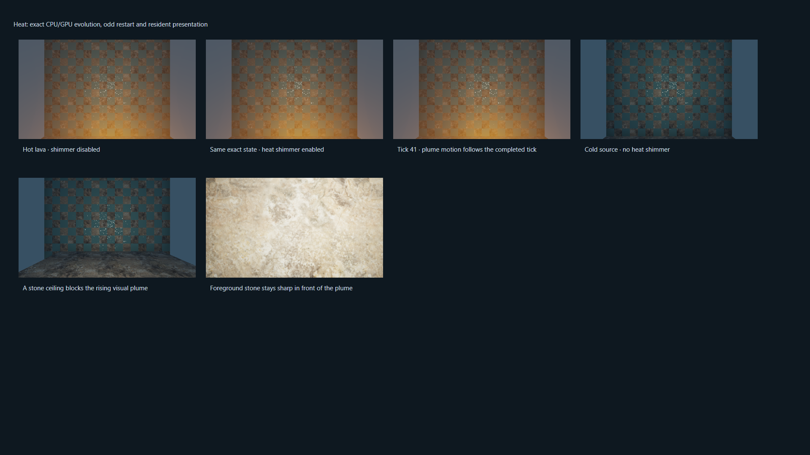
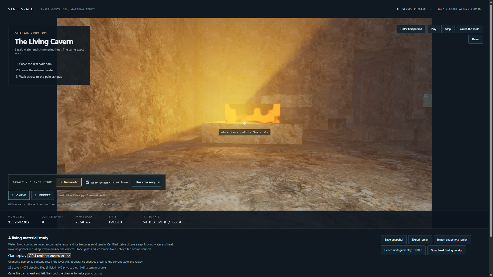

# Native cavern heat distortion

October 16, 2026. Presentation identity `cavern-heat-1`, extending the naturalistic
rock, water/ice and volumetric haze renderer on `codex/cavern-materials`.
Physics rules, catalog, seeded world, controller and portable replay are unchanged.
Legacy demos remain quarantined and the incident safety hold remains active.

## Presentation contract

Exposed hot lava/molten-glass sources now produce shimmering cavern air. The
existing quarter-resolution volume pass integrates an upward visual plume from
its selected emitters. Gravity is +Y, so the plume extends toward decreasing Y
up to 12 voxels. Its radius broadens with height and fades smoothly at its edges.
Terrain shadow rays block the contribution. Only air and steam samples contribute;
primary rays still terminate at the nearest surface or 48 voxels, in 32 steps.

World-space turbulence advects upward using the completed absolute tick. It
shares the existing optical uniform and 36,000-tick period. Integrated displacement
is capped at six pixels at 1080p, scaling with vertical resolution. A third
quarter-resolution rgba16float target stores the vector, nearest contributing
sample depth and weight, adding about 0.99 MiB at 1080p. No new render pass,
submission, completion boundary, physical buffer or state readback is added.

The post-process upsamples displacement with the same depth-aware weights as
haze, then bilinearly samples HDR background color. It rejects the displacement
at canvas edges, where the original surface is in front of the plume, or where
any donor tap crosses a significant depth discontinuity. Volume scattering and
surface bloom keep their original coordinates. The original fog pass and its
resource cleanup/resize behavior remain intact.

`await renderer.setHeatDistortion(boolean)` is an optional method on chunked GPU
terrain renderers. It defaults on in naturalistic mode and has no effect in
diagnostic mode. Invalid values and overlapping field operations reject before
changing it. The cavern's **Heat shimmer** checkbox uses this operation boundary.
A/B appearance switching, resize, reset and import preserve the setting. It is
presentation state, excluded from physical snapshots; benchmark receipts record
it explicitly. The existing naturalistic/diagnostic A/B switch remains available.

This is approximate emitter-driven screen-space refraction. It does not solve a
physical hot-air refractive field or alter thermal transport. The light budget
remains one exposed hot source per chunk and two selected sources per view ray;
plume coverage therefore approximates large or crowded lava pools. Quarter
resolution, 32 steps and conservative depth rejection limit thin features and
silhouette distortion. Water/ice reflections and volumetric haze are not
recursively refracted through the plume. Image equality is tested on the same
backend; physics retains its separate exact integer contract across clients.

## Verification

Portable receipts, source hashes, captures and attempts are indexed by
[`cavern-heat/manifest.json`](cavern-heat/manifest.json).

- SDK build, type checking, structural lint, 61 engine tests and 18
  controller/rendering tests pass. Nineteen isolated supervisor tests cover
  containment and source-current prerequisite gates, including the new heat probe.
- The bounded kernel probe retains complete CPU/dense/sparse equivalence,
  odd/single-cell dimensions and mesh-oracle equality.
- A 16³ heat fixture compares identical physical states with only shimmer
  enabled/disabled. It checks changed background pixels above lava, unchanged
  pixels outside the plume, no effect from cold stone, blocking by a stone
  ceiling, and an unchanged foreground wall in front of the heat source.
- Paused images, restored images, diagnostic mode, invalid/busy toggle rejection,
  camera/resize round trips, and completed-tick animation are checked separately.
  Twelve evolution ticks match full CPU states, including restart at tick 3.
  Resident gameplay step and view-only present use the same heat animation tick.
- Material lighting, water/ice optics and steam/fog regression probes still pass.
  The 128³ restart trajectories 3→31 and 509→600 match complete retained CPU
  game/field snapshots. A/B changes do not affect the trajectory. Each gameplay
  frame still has one queue submission and one completion boundary.
- UI checks exercise the independent shimmer switch, A/B isolation, backend
  selection, play/pause/step, snapshot imports/exports, the tick-191 crossing,
  benchmark cancellation and software-error recovery.

The CPU oracle and compressed fixtures remain in
[`volume-m4/reference`](volume-m4/reference/node-original.json). Complete initial
and final states and the entire 600-command tape are compared, not only digests.
No legacy demo trajectory or aggregate native/release suite is part of this gate.

## Full gameplay frame

RTX 4090 (driver 595.79), i9-11900K, Windows 11 Home 10.0.26300,
hardware WebGPU in HeadlessChrome 155.0.0.0. Configuration: 128³, 1920×1080,
resident GPU gameplay, all naturalistic effects and heat distortion enabled,
60 warmup frames and 600 measured display-paced frames.

| Metric | Untraced acceptance run |
| --- | ---: |
| Actual simulation rate | 59.95 Hz |
| Full-frame median | 6.5 ms |
| Full-frame p95 | 7.8 ms |
| Full-frame p99 | 8.7 ms |
| Worst frame | 9.5 ms |
| Missed 60 Hz deadlines | 0 |
| Lost display slots | 0 |
| Energy drift | 0 |

The strict 60 Hz gate passes. The final run also passes the earlier sub-8 ms p95
threshold. The first valid run measured approximately 8.0 ms p95 (its raw `<8`
flag reflects floating-point residue), so these receipts do not establish a
repeatable margin below 8 ms. Both runs are retained. Combined haze/heat GPU work
measured about 0.13 ms p95 in the separate timestamp run; timestamps are quantized
at roughly 0.066 ms. Raw warmup, all 600 measured samples and the timing breakdown
are retained in [`summary.json`](cavern-heat/summary.json) and indexed receipts.

The full-frame measurement includes tools, exact physics, collision/controller,
mesh, lighting, rock/water/ice optics, haze and heat, tone mapping/bloom, compact
readback, HUD, validation and GPU completion. Setup, shader/texture loading,
snapshot serialization/hashing and OS scanout are outside the timed loop.
The separate GPU timestamp run is diagnostic; stage percentiles must not be
summed. This is one scripted route and machine, not an arbitrary scene or
physical input-to-photon guarantee.

Initial complete-state digest:
`5694fed11bf10fd458bcf74191d5592f3ef45773e87a090c8c9f3f97a06faeea`.
Final complete-state digest:
`506105f11ef608ead0ab8bb83c2b9a90f07c7a7941849a807f11b93da9cdc7da`.

## Safe reproduction

Run `python -m scripts.recover_m4_verification <stage> --browser-cli <installed-cli>`
one stage at a time. After CPU/build prerequisites: `probe`, `appearance-probe`,
`optics-probe`, `haze-probe`, `heat-probe`, `appearance-replay`, `appearance-ui`,
`frames128beauty` and optional `appearance-timing`. Inspect each receipt before
advancing. Exact replay now requires a passing, source-current heat probe.
The exclusive lease, process-tree containment, memory/CPU limits, resource
preflight, progress watchdog and frame responsiveness gates remain unchanged.
The incident hold remains suspended between explicitly permitted stages.

All bounded stages passed on their first runtime attempt for this heat change.
Final review strengthened the invalid/busy-toggle assertions to inspect the
setting without resetting it first; the heat probe and source-bound full-frame
receipt were refreshed afterward, with no rendering-code change.
No verification resource limit, responsiveness threshold or performance gate was
relaxed. The legacy quarantine remains in effect.

## Captures

