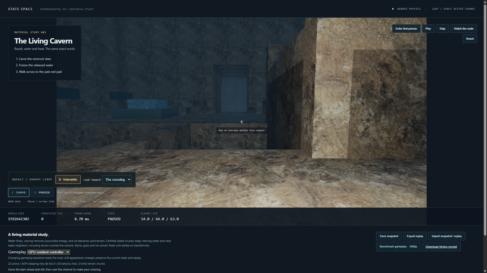
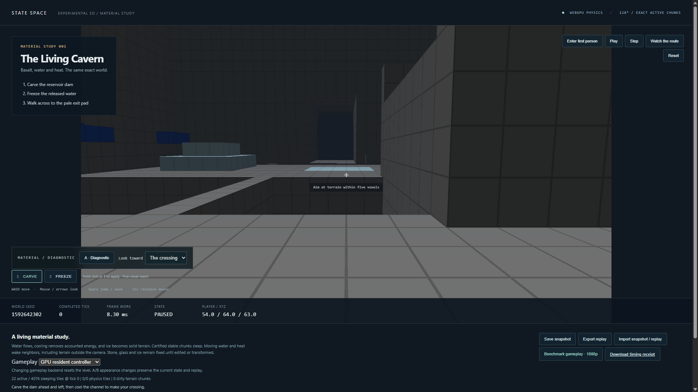
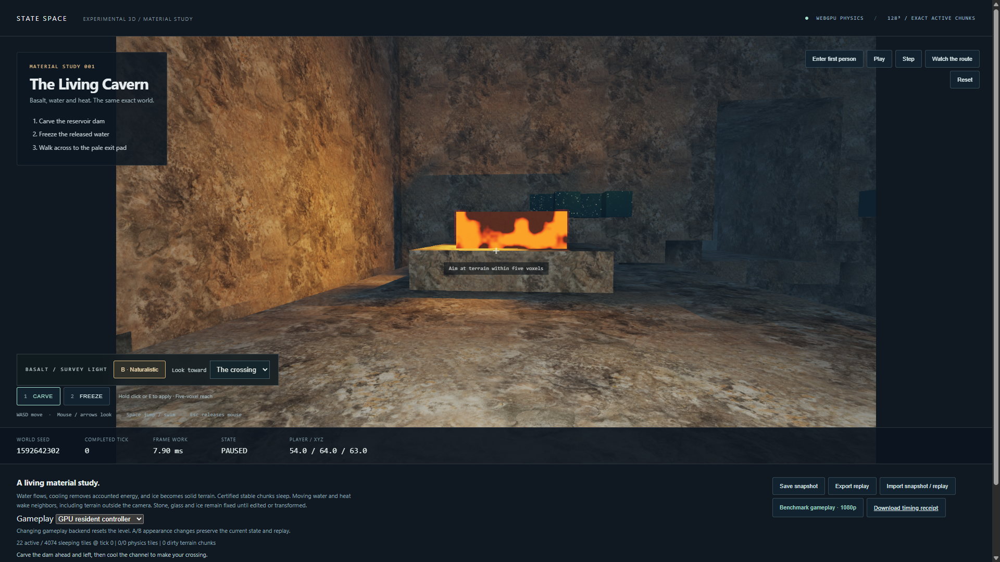

# Naturalistic cavern material study

October 15, 2026. Built on M4 commit `2c8b829` on `codex/cavern-materials`.

The targeted material, lighting, replay, UI and 128³ resident gameplay gates pass.
The original physics rules, seeded world, controller and command tape are unchanged.
Legacy 2D demo trajectories remain quarantined. The full repository release gate
is still open, and the local incident hold remains active.

## Presentation

The existing Living Cavern now opens with the naturalistic appearance: scanned
rock color and surface normals, filtered fine detail, mineral veins and fissures,
roughness and wet-contact shading. A warm survey lamp follows
the camera. Exposed hot lava/molten glass illuminate nearby surfaces. Terrain
casts bounded local shadows; corner occlusion adds contact shading. An HDR target
feeds tone mapping and a restrained nine-tap bloom filter.

The A/B button selects naturalistic or the original diagnostic view without a
reset, physical edit, tick or replay command. The view selector turns toward the
crossing, lava basin or ice shelf. The optional SDK method is
`await renderer.setAppearance('naturalistic' | 'diagnostic')`; chunked renderers
default to diagnostic. The appearance module, pipelines and textures load on
first selection and are reused. Diagnostic startup does not load the texture
payload. The bundled 1K CC0 rock maps have full mip chains and anisotropic
filtering, with sRGB decoding for color and linear normal/roughness data.
Asset provenance is retained in [third-party credits](../THIRD_PARTY.md).

The same GPU face lists serve both views. All appearance shaders bind physical
state read-only. Light extraction, HDR drawing and post-processing share the
resident gameplay encoder, submission and completion boundary. No appearance
state enters snapshots or the external-energy ledger. Reset/error recovery
recreates the selected appearance.

Limits are explicit: voxel silhouettes and collision surfaces are unchanged;
water and ice remain opaque; steam remains a diagnostic marker. The renderer
selects one exposed hot emitter per storage chunk with a 22-cell influence
radius. Two bounded visibility samples approximate local shadows. Ambient fill
is artistic, not simulated indirect illumination. Wetness follows adjacent
water; it is not a new physical field. HDR rendering adds about 15.8 MiB at 1080p,
16 MiB of texture mip chains and a 2 KiB light buffer for the default 64 storage
chunks. The optional texture module is about 3.1 MB before transport compression.

## Verification

- The existing bounded GPU probe passes complete CPU/dense/sparse state and
  per-pass checks, including odd and single-cell dimensions.
- A new 16³ material fixture compares complete CPU/GPU states through 12 ticks,
  an edit and restart at tick 3, with zero energy drift. It checks invalid modes,
  paused pixel stability, exact diagnostic A/B round trips, camera isolation,
  removal/restoration of an emitter, and an opaque wall shadowing a stone
  receiver outside the emitter's pixels.
- At 128³, appearance alternates on every frame from saved ticks 3→31 and
  509→600. Complete game/field snapshots match the retained dense CPU fixtures.
  Intercepted WebGPU calls confirm one submission and one completion per frame.
- The full 600-frame gameplay benchmark compares its initial/final snapshots
  and entire command tape against the existing M4 CPU reference. Energy drift
  is exactly zero, and the physical ice crossing remains at tick 191.
- UI checks cover both controller selections, A/B state isolation, invalid
  appearance rejection, paused idle behavior, same-tick redraw, snapshot import,
  exported-state isolation, route completion, benchmark cancellation and
  injected-error recovery.
- SDK build and type checking pass. Structural lint passes. The bounded unit
  suite passes 60 engine tests and 18 controller/rendering tests. Sixteen
  isolated supervisor tests pass, including new checks that stale appearance
  proofs or a failed small probe cannot authorize a larger run.

The unchanged M4 CPU fixture archive is retained at
[`volume-m4/reference`](volume-m4/reference/node-original.json). Current source
and artifact hashes, raw measurements, runtime telemetry and attempts are listed
in the [material-study manifest](cavern-materials/manifest.json).

## Full-frame result

Measured on an RTX 4090, NVIDIA 595.79, i9-11900K, Windows 11 Home 10.0.26300,
hardware WebGPU in HeadlessChrome 155.0.0.0. Resolution: 1920×1080. World: 128³.
Resident GPU controller, naturalistic appearance, 60 display-paced warmup frames
and all 600 measured frames. No outlier removal or tick skipping.

| Metric | Final untraced run |
| --- | ---: |
| Actual simulation rate | 59.95 Hz |
| Full-frame median | 7.2 ms |
| Full-frame p95 | 9.1 ms |
| Full-frame p99 | 9.6 ms |
| Worst frame | 10.0 ms |
| Missed 60 Hz deadlines | 0 |
| Lost display slots | 0 |
| Frames at or above 8 ms | 130 / 600 |
| Energy drift | 0 |

The result includes command handling, tools, all exact physics, collision and
controller work, light extraction, mesh updates, material shading, HDR/post,
readback, HUD updates, validation and GPU completion. Setup, shader compilation,
snapshot serialization, source hashing and OS scanout are outside the timed loop.
The GPU-timestamp run is retained separately as a diagnostic; stage percentiles
are not added together. These results describe this route and machine, not a
guarantee for arbitrary worlds, view directions or other hardware. The CPU
controller remains the default reference and is not the controller timed here.

This final texture-backed pass meets the 60 Hz gate. It does not meet the earlier
sub-8 ms p95 target. The separate GPU-timestamp run also meets 60 Hz; its p95
light-extraction, terrain-draw and tone/bloom durations are 0.197, 0.328 and
0.066 ms respectively. Browser GPU timestamps are quantized to about 0.066 ms;
a reported zero is below that resolution, not free work. The full-frame result
above remains the acceptance measurement, including CPU and synchronization work.

Initial complete-state digest:
`5694fed11bf10fd458bcf74191d5592f3ef45773e87a090c8c9f3f97a06faeea`.
Final complete-state digest:
`506105f11ef608ead0ab8bb83c2b9a90f07c7a7941849a807f11b93da9cdc7da`.
Both are identical to M4.

## Safe reproduction and retained attempts

Use `python -m scripts.recover_m4_verification <stage> --browser-cli <installed-cli>`
one stage at a time. After build/unit prerequisites: `probe`, `appearance-probe`,
`appearance-replay`, `frames128beauty`, optional `appearance-timing`, then
`appearance-ui`. Inspect each receipt before proceeding. These commands retain
the incident hold and use command-specific permits, a single process-tree lease,
CPU/memory containment, health checks, progress timeouts and cancellation.
The frame responsiveness and 60 Hz gates are unchanged. No legacy demo is run.

Two preflight attempts were blocked by transient CPU load before a workload
launched. Early lighting assertions exposed an invalid pixel-capture method:
direct WebGPU-to-2D copying returned transparent pixels. The test now decodes a
captured PNG before sampling the receiver. An early replay fixture also supplied
an unsupported camera `eye` to the resident controller; the public validator
rejected it. One later replay attempt stopped at the 100 ms responsiveness limit;
host telemetry was retained, and no cause is asserted from that incomplete trace.
The next bounded replay passed with additional frame diagnostics and the same
limit. SDK declaration generation initially rejected an inferred literal
type for the embedded texture strings; an explicit string-array type corrected
that build error. These failed attempts and intermediate material revisions remain
retained alongside passing results. No safety threshold was relaxed. Software
containment reduces exposure; it cannot guarantee prevention of a host hang.

## Comparison captures

Same tick, physical world and camera:

Lava basin from the same player position:

