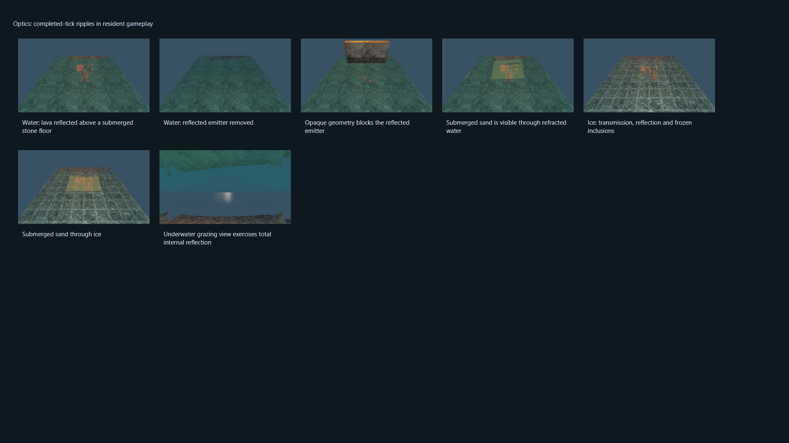
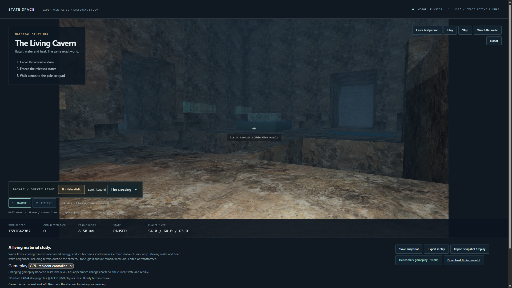

# Native water and ice optics

October 15, 2026. Extends `cavern-materials-1` on `codex/cavern-materials`.
The new presentation identity is `cavern-optics-1`. The physical rules, catalog,
seeded world, controller and replay format are unchanged. Legacy demos remain
quarantined; the incident safety hold remains active.

## Presentation

Naturalistic water now reflects terrain and lava, refracts submerged surfaces,
and absorbs light with depth. Fresnel reflectance strengthens reflections at
grazing angles. Water uses refractive index 1.333; ice uses 1.31, weaker absorption,
static inclusions and frosted edges. Water ripples follow the completed absolute
tick and pause with the simulation. They repeat after 36,000 ticks. Optical
normals change shading only: voxel silhouettes, water movement, frozen terrain
and collision surfaces remain exact.

Two bounded rays traverse the committed GPU voxel grid per water/ice fragment:
one reflection and one transmission. Offscreen and mesh-hidden terrain can be
seen by these rays. Each traverses at most 64 cells and 40 voxel units, with up
to four subsequent dielectric interfaces for exit refraction and total internal
reflection. Opaque cells stop a ray immediately. A miss or exhausted budget
returns the dark cavern fill, with accumulated water/ice absorption.

This is approximate single-bounce optics. Secondary hits use simplified rock
shading and unshadowed direct illumination; secondary mirror reflections,
caustics, dispersion, rough-reflection convolution and volumetric multiple
scattering are not implemented. Nested transparent interfaces beyond the fixed
budget use the fallback. Water and ice remain cubes; no surface reconstruction
or simulated waves are implied. Glass retains its earlier opaque material.

The existing A/B button compares naturalistic optics with the original opaque
diagnostic palette. SDK callers continue to use
`await renderer.setAppearance('naturalistic' | 'diagnostic')`. The naturalistic
pass remains optional and lazy-loaded. No new render pass, readback, completion
boundary or screen-sized optical history is added. A 16-byte visual uniform
supplies the completed tick; resident gameplay explicitly passes the same tick
whose physical state it is drawing.

## Verification

The retained receipts and source hashes are indexed by
[`cavern-optics/manifest.json`](cavern-optics/manifest.json).

- The bounded kernel probe still matches CPU/dense/sparse complete states,
  including odd and single-cell dimensions. Existing material-light assertions
  still pass, with camera/A-B isolation and zero energy drift.
- A 16³ optical fixture places every corner of a lava emitter outside the primary
  camera frustum. Removing it changes the reflected receiver; placing an opaque
  blocker stops the reflection. Changing submerged stone to sand changes
  transmission through both water and ice. Frozen water has a distinct image.
- Paused water pixels are stable. Restoring water/ice snapshots reproduces their
  images exactly. An underwater grazing view exercises total internal reflection.
- The fixture steps resident gameplay, then presents the committed state again:
  the pixels are identical. Snapshot/actor restore also reproduces those pixels.
  The complete physical state after the step matches the CPU reference.
- At 128³, replay from ticks 3→31 and 509→600 alternates the A/B appearance on
  every step and matches complete retained CPU game/field snapshots exactly.
  Each gameplay frame still has one queue submission and one completion boundary.
- UI verification covers backend selection, A/B isolation, playback, paused idle,
  snapshot import/export, crossing at tick 191, cancellation and error recovery.
- Build, type checking, structural lint, bounded unit tests and isolated
  verification-supervisor regression tests are retained separately: 60 engine,
  18 controller/rendering and 17 supervisor tests pass.

The CPU fixture is unchanged from M4; its portable archive is
[`volume-m4/reference`](volume-m4/reference/node-original.json). The entire
600-frame command tape and initial/final snapshots are compared, not just counts
or digests. No 2D demo trajectory or aggregate release suite is part of this gate.

## Full gameplay frame

The acceptance run uses the RTX 4090 with driver 595.79, i9-11900K, Windows 11 Home
10.0.26300 and hardware WebGPU in HeadlessChrome 155.0.0.0. Configuration: 128³,
1920×1080, resident GPU gameplay, naturalistic appearance, 60 warmup frames and
600 measured display-paced frames. Every measured frame is retained.

| Metric | Final untraced run |
| --- | ---: |
| Actual simulation rate | 59.95 Hz |
| Full-frame median | 7.1 ms |
| Full-frame p95 | 8.6 ms |
| Full-frame p99 | 9.3 ms |
| Worst frame | 9.8 ms |
| Missed 60 Hz deadlines | 0 |
| Lost display slots | 0 |
| Energy drift | 0 |

The 60 Hz gate passes. The earlier sub-8 ms p95 target is not met by this
material configuration. Raw measurements and the separate GPU timing run are
recorded in [`summary.json`](cavern-optics/summary.json).

Initial complete-state digest: `5694fed11bf10fd458bcf74191d5592f3ef45773e87a090c8c9f3f97a06faeea`.
Final complete-state digest: `506105f11ef608ead0ab8bb83c2b9a90f07c7a7941849a807f11b93da9cdc7da`.
Both remain identical to M4.

Timing includes commands/tools, exact physics, collision/controller, mesh updates,
light extraction, rock/water/ice shading, reflections/refraction, HDR/bloom,
compact readback, HUD, validation and GPU completion. Setup, texture loading,
pipeline compilation, snapshots, hashing and OS scanout are outside the timed
loop. The separate GPU-timestamp run is diagnostic; stage percentiles must not
be summed. This is evidence for the listed route and machine, not an arbitrary
world, camera or hardware guarantee.

## Safe reproduction

Run `python -m scripts.recover_m4_verification <stage> --browser-cli <installed-cli>`
one stage at a time. After CPU/build prerequisites: `probe`, `appearance-probe`,
`optics-probe`, `appearance-replay`, `frames128beauty`, optional `appearance-timing`,
and `appearance-ui`. The replay now requires a passing, current optical probe.
Source freshness includes the optical shader. The incident hold, process-tree
lease, CPU/memory containment, resource preflight, progress timeouts and frame
responsiveness limits remain unchanged.

An early optical fixture exceeded the public 64-edit batch limit while replacing
the entire pool with ice. The validator rejected it. The fixture now restores a
CPU-authored frozen snapshot, preserving the existing API limit. Intermediate
and failed attempts are retained alongside the final receipts. A diagnostic
run was also blocked before launch by the existing CPU-load gate; the later
guarded attempt passed. No resource limit or acceptance threshold was relaxed.

## Captures

The optical fixture isolates offscreen reflection, occlusion and transmission:

The unchanged cavern's ice shelf:

