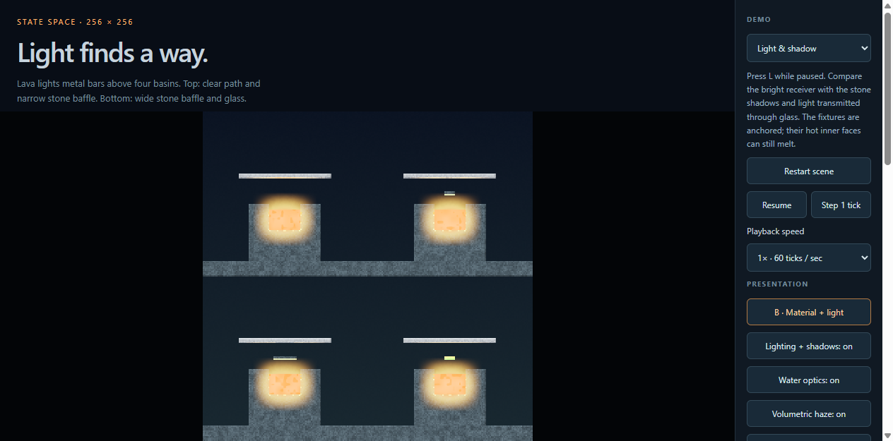
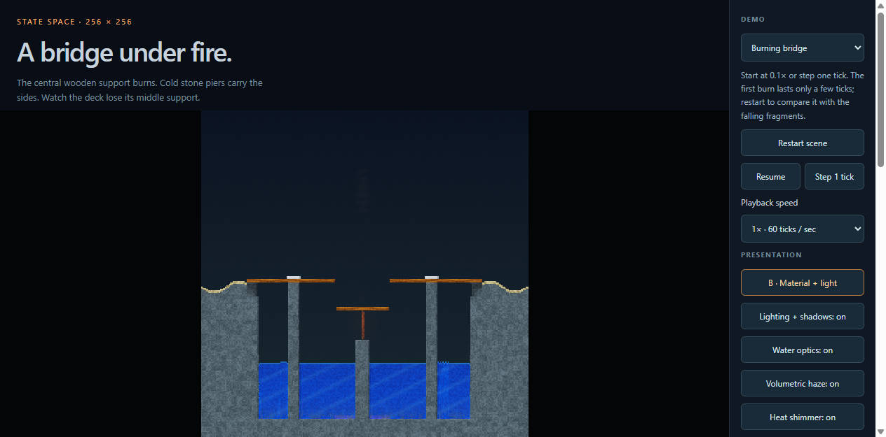
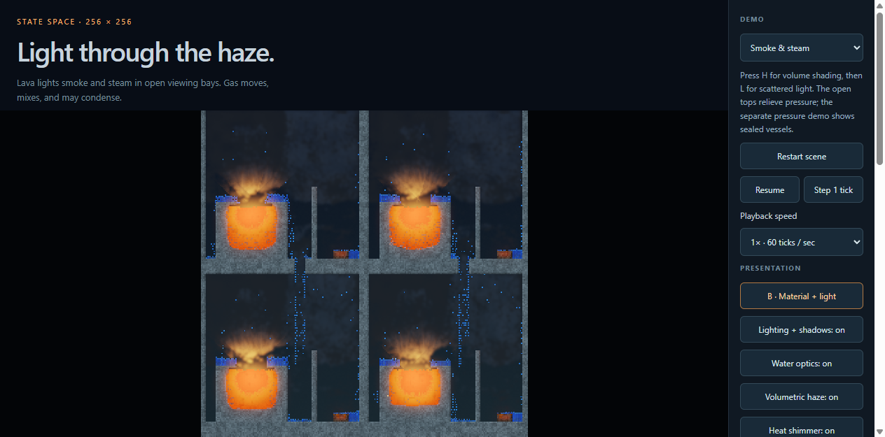

# Demo refresh for ca-v4

The demos now account for global support paths, hydrostatic loads, finite fuel,
and hot-gas pressure. Physics rules, the material catalog, shaders, and the SDK
bundle are unchanged. This changes initial conditions and viewing controls.

## What changed

| Demo | Repair and intended observation |
| --- | --- |
| Burning bridge | Anchor the masonry rather than making the deck carry the riverbanks. Expansion joints isolate a central span on a narrow wooden pin. Its unlit control stays standing for 132 ticks; heating the pin makes the span drop within 12 ticks. |
| Light and shadow | Replace 64 melting, collapsing micro-reservoirs with four shallow basins and cool, supported outer shells. Receivers remain above the openings within the light's range. Compare clear, narrow stone, wide stone, and glass paths. |
| Fire and water | Use the supported basin geometry above the pool, retaining emitters and reflections while the inner stone faces melt. Small wooden fires remain deliberately finite. |
| Smoke and steam | Vent the viewing bays, including a shaft through each upper floor. Place hot steam and smoke within illumination range and retain sufficient finite heat for a useful viewing interval. |
| Heat shimmer | Keep contrasting gas bands above supported reservoirs. Bands mix naturally; restart or compare while paused to inspect their early shape. |
| Pressure | Reinforce the demonstration platforms and separate the lower lava bowl from the vessel comparison. In the first 30 ticks, wood breaches and metal holds; sealed glass ruptures while vented glass retains its walls. Later condensation and heating still change the scene. |
| Engine lab | Run the falling plate for 24 ticks so it actually hits and displaces water. Remove the pre-broken integrity setting from the heated pin. Correct the old claims that pressure does not exist. |

All showcases open paused. Single-step (button or period key), 0.25× and 0.1×
playback, complete-state restart, scene navigation, and per-scene viewing notes
make rapid events inspectable. Speed changes only tick scheduling. No playback
refills, forced failures, repairs, or hidden heat injection are used.

## Verification

- 60 SDK tests, 14 browser scheduling/demo tests, 5 lab tests, and 9 native rendering tests passed.
- TypeScript type checking and engine structural lint passed.
- The browser exercised the actual single-step button at 1×, 0.25×, and 0.1×, compared it with direct API stepping, and verified exact restart and the keyboard shortcut.
- Five presentation toggle checks preserved the complete physical state.
- All 62 rendered/replayed trajectories matched the independent CPU reference, with zero thermal/latent/chemical energy drift.
- At tick 132, the native isolated haze comparison illuminated 1,146 smoke and 1,519 steam cells with a red-channel gain above 20, with bloom disabled. Heat distortion changed 1,217 open cells and zero opaque cells at an RGB threshold of 2.
- The long runs retained the active sources, water, smoke, and steam required by the existing benchmark gates. No acceptance threshold was relaxed.

The SDK bundle remains `a287960647bea48ebd90fbccd02b5787df73edc4abf6268a25547ae5b75683bc`.
The [raw receipt](demo-refresh-frames/frames.json) binds the exact source hashes,
records all commands and trajectories, and confirms sources were unchanged
throughout measurement. Test logs are in [demo-refresh-tests](demo-refresh-tests/).

## Full-frame performance

Measured 2026-10-13 UTC on the i9-11900K / RTX 4090, driver 595.79, at 256×256
simulation resolution and 1920×1080 output with every effect on. All seven scenes
passed the existing strict 60 Hz gate: **zero deadline misses across 4,200 measured
frames**, a **14.4 ms** worst callback-to-GPU-completion time, and no missed or
coalesced callbacks. Callback, completion, and physics cadence stayed within
59.9–60.1 Hz. The separate browser and native throughput runs each had zero
16.67 ms overruns across 2,916 samples.

| Scene | Paced frame work p95 (ms) | Worst callback completion (ms) | Native styled p95 (ms) |
| --- | ---: | ---: | ---: |
| bridge | 11.90 | 13.50 | 8.05 |
| emissive | 11.50 | 13.00 | 7.15 |
| lighting | 11.90 | 13.40 | 7.94 |
| water | 11.80 | 14.40 | 8.50 |
| haze | 12.40 | 14.20 | 9.46 |
| heat | 12.20 | 14.10 | 9.57 |
| pressure | 12.00 | 14.40 | 9.38 |

Each paced scene measures 600 frames after 60 warmup callbacks. The dense
emissive scene completed one extra tick during warmup (end tick 661); its measured
window still contains exactly 600 ticks and its final native replay matches that
actual end tick. All other paced scenes ended at tick 660.

Timing includes physics, global planning, validation, transfers, rendering, and
GPU completion. Startup, reference hashing, and OS scanout are excluded. Host
load and browser timing still matter; these are measured application deadlines.
[GPU load](demo-refresh-frames/gpu-load.json) was 8% before and 7% after the run.
These are revised workloads; the older pressure performance report remains the
record of the previous fixtures.

Reproduce after `npm run build:sdk`:

```powershell
npm test
node --test examples/lab/lab.test.mjs
uv run python -m unittest tests.test_rendering -v
uv run python -m engine.lint
npm run typecheck
uv run python -m scripts.benchmark_frames --browser-cli <agent-browser-cli> --output <new-evidence-directory> --require-locked
```

## Browser captures




