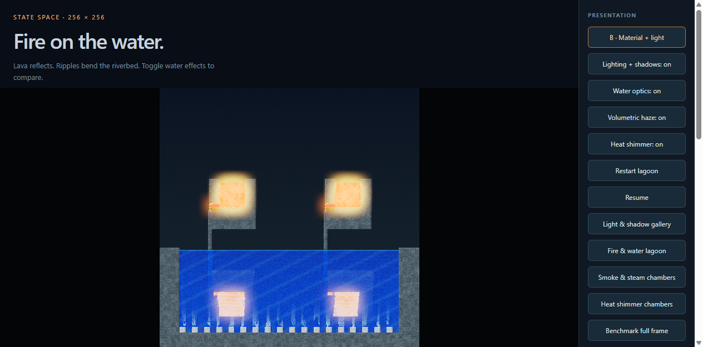

# Browser frame pacing: 256 × 256 full frames

The browser now arms its next display callback before awaiting GPU work, bounds
pending work to one timestamp, and drops time from callbacks it could not serve.
This prevents a slow frame from starting a continuing multi-tick catch-up loop.
Executed physics ticks remain consecutive and exact. Rounded timestamps have a
0.5 ms tolerance, with any early phase carried forward. Paused, unchanged views
keep their image; status text updates four times per second.

Private readback and planner buffers, caller-owned rendering copies, uniforms,
and texture views persist between frames. This removes about 3.25 MiB of large
coordinate-array allocations per ordinary 256 × 256 `step(1)` plus render on the
Wasm-backed path. It still copies and validates complete GPU readbacks. Committed
storage swaps only after the full step and GPU error scope succeed; failures can
retry from the same state. Public getters and snapshots keep returning independent
copies. `copyStateInto` validates all destinations before writing and rejects
in-flight steps, including a step started by a caller's Proxy descriptor trap.

Ordinary browser ticks encode the same 18 ordered physics dispatches in one
compute pass. WebGPU defines [each compute dispatch as a usage scope](https://www.w3.org/TR/webgpu/#usage-scopes).
Inspection retains its per-kernel submissions and independent reports. Physical
kernels, solver arithmetic, shared rendering WGSL, effect quality, and resolution
are unchanged.

## Acceptance and measurement

Windows x64, Intel i9-11900K, NVIDIA RTX 4090, driver 595.79; Python 3.10.16 /
wgpu 0.31.0 and hardware WebGPU in Headless Chrome 154. Native rendering is
offscreen. Simulation is 256 × 256; output is 1920 × 1080, with material shading,
heat glow, dynamic lighting, soft shadows, water reflections/refraction,
volumetric smoke/steam, heat distortion, and bloom enabled.

The production clock and callback pump drive five trajectories, each with 600
measured frames after 60 warmup frames. The gate requires 59.9–60.1 Hz callback,
completion, and physics cadence, every frame completed within 16.67 ms of its
callback, and zero missed display slots or coalesced callbacks. It checks GPU
completion rather than submission time. Raw callback/start/completion timestamps,
work distributions, and every failure are retained. Startup, reference replay,
hashing, screenshot readbacks, and operating-system scanout are outside timing.

## Current result: the overall 60 Hz gate fails

The [final receipt](pacing/frames.json) captures the implementation after dispatch
batching. GPU utilization was **95% before this run and 80% after it**, with a
separate graphics workload active; the [boundary readings](pacing/gpu-load.json)
are retained. This is a measurement under contention. A quiet-GPU qualification
is still needed before claiming locked 60 Hz across all scenes.

| Browser scene | Callback Hz | Completed Hz | Physics Hz | Median work | p95 work | Maximum work | Missed deadlines / 600 | Missed slots | Coalesced callbacks |
| --- | ---: | ---: | ---: | ---: | ---: | ---: | ---: | ---: | ---: |
| Burning bridge | 59.850 | 59.831 | 59.850 | 12.70 ms | 15.10 ms | 40.50 ms | 8 | 1 | 1 |
| Lighting gallery | 59.950 | 59.947 | 59.950 | 12.85 ms | 14.90 ms | 16.30 ms | 0 | 0 | 0 |
| Water lagoon | 59.949 | 59.929 | 59.949 | 13.10 ms | 15.70 ms | 21.10 ms | 23 | 0 | 0 |
| Haze chambers | 59.950 | 59.966 | 59.950 | 13.20 ms | 16.00 ms | 19.40 ms | 31 | 0 | 0 |
| Heat chambers | 59.952 | 59.968 | 59.952 | 14.00 ms | 16.90 ms | 22.00 ms | 56 | 0 | 0 |

**118 of 3,000 frames missed their completion deadline.** Lighting passed its
individual gate; the other scenes failed. Counting only work overruns would miss
frames whose late start pushed completion past their callback deadline.

The [earlier full attempt](pacing-loaded/frames.json), before dispatch batching,
retains 14 deadline misses and no missed slots/coalesced callbacks. Its GPU
boundary readings were 97% / 90%. Host contention changed between attempts, so
these separate runs do not establish a causal speedup or regression from batching.
An isolated 600-frame heat probe after batching passed every deadline, but the
five-scene result above is the acceptance result; that probe cannot replace it.

The receipts also retain 21 unpaced scene/view comparisons per backend, each
measuring 120 frames after 12 warmup ticks. The final run records 57 browser and
439 native work overruns among 2,520 samples per backend. These include plain,
styled, alternating, and individual water/haze/distortion-off comparisons. No
outliers were discarded. Native timings here also reflect the contended host.

## Exact state and release evidence

All **47 rendered trajectories plus five longer native continuations** matched
the CPU reference, with zero energy drift. Each paced trajectory runs without
resets or injected sources; the four stress scenes retain finite lava, and the
gas scenes retain more than 1,024 smoke and steam cells at the end. The bridge
ended at absolute tick 662; the others at 660. Native and CPU references replay
those actual tick counts outside the frame clocks.

[Final verification](pacing-final-verification.json) passed all **16 gates**:
146 native tests, 55 SDK tests, 11 browser scheduling/rendering tests, both game
suites/builds, installed SDK clients, the live lab, and adversarial evaluation.
[Hardware browser conformance](pacing-final-verification-browser/conformance.json)
matched **31 scenes / 2,304 per-pass comparisons**. Injected second-readback
mapping failures and malformed coordinates prove multi-tick rollback and exact
retry. Reusable copies reject concurrent/reentrant access and preserve isolation.

Verification and the final frame benchmark captured identical source manifests;
each confirmed sources stayed unchanged during its run. The
[installed-package report](pacing-final-verification-sdk.json) links the
content-addressed wheel and npm archives actually tested. The prior npm archive
is retained for the earlier benchmark's bundle identity.

## Reproduce

Run on an otherwise quiet GPU after building the SDK:

```powershell
npm run build:sdk
uv run python -m scripts.benchmark_frames --browser-cli <agent-browser-launcher> --output dist/performance/pacing --require-locked
```

`--require-locked` writes the complete receipt before returning a failure if any
scene misses the gate. Long CPU reference replays yield between exact batches,
and the harness retains command/error evidence if browser control fails.


