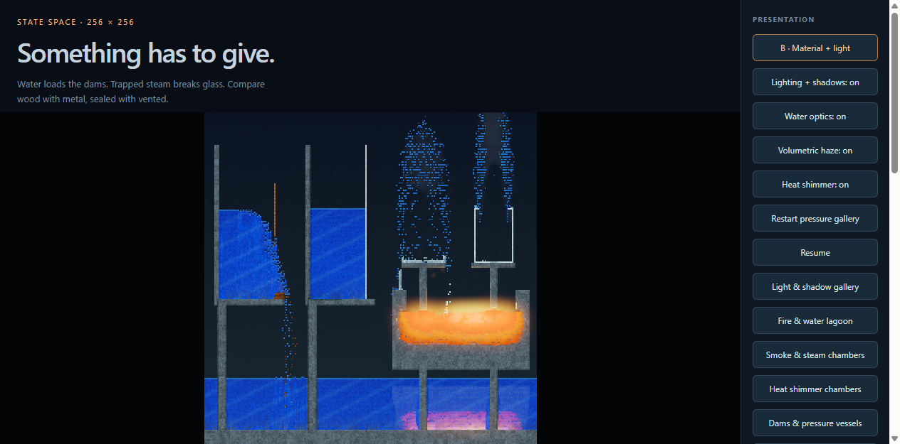
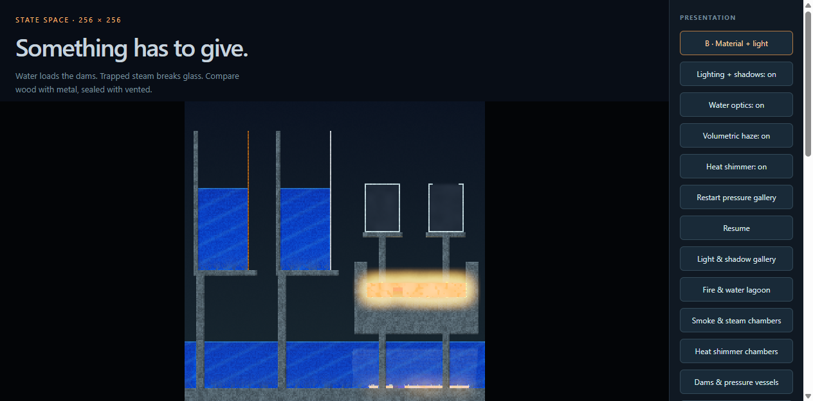

# Pressure and velocity: 256 × 256 full-frame measurements

The ca-v4 engine adds global integer cellular pressure, pressure damage and
quantized velocity transport without expanding the three-u32 cell state. A tick
now contains 23 passes. See [the physical law](../PRESSURE.md) for its exact
arithmetic and limits: this is a cellular model with exact thermal/latent/chemical
energy accounting, not a continuum or momentum-conserving solver.

## Current result: merged catalog still fails the strict lock

PR #14 now incorporates main through `8aed26dcf5e23e0ca40698adb0284a8031f9db3d`,
including PR #15's water-freezing correction. Generated catalogs retain schema 4
and `ca-v4`; water freezes at 15 model units, below the ambient 20. The new catalog
hash is `f5e8af40e58281e2e8b5d343fddbc849c1daecfa54d4a51ea10d4b3bf9ce5ce7`.
The pressure and velocity laws are unchanged.

The [merged-catalog full-frame run](pressure-merged-frames/frames.json), recorded
October 12, 2026 PDT, reports **`locked60: false`**. All 60 rendered/replayed
trajectories match the CPU reference across all three coordinates, with zero
thermal/latent/chemical energy drift. All five UI isolation checks pass.
Three of 3,600 measured display-paced frames miss their completion deadline:
one bridge frame and two lighting frames. No display slots or callbacks are lost
or coalesced. The pressure, water, haze and heat scenes pass the strict gate.
This result does **not** qualify PR #14 for merge under the requested 60 Hz gate.

| Scene | Callback Hz | Median work ms | p95 work ms | Max work ms | Max callback-to-completion ms | Deadline misses / 600 |
| --- | ---: | ---: | ---: | ---: | ---: | ---: |
| Burning bridge | 59.949 | 10.20 | 11.70 | 16.40 | 16.80 | 1 |
| Lighting gallery | 59.950 | 11.00 | 12.90 | 24.90 | 25.10 | 2 |
| Water lagoon | 59.949 | 10.00 | 11.60 | 15.90 | 16.20 | 0 |
| Haze chambers | 59.950 | 11.20 | 13.10 | 14.70 | 15.00 | 0 |
| Heat chambers | 59.949 | 10.30 | 11.80 | 16.00 | 16.30 | 0 |
| Dams and vessels | 59.950 | 10.20 | 11.90 | 13.20 | 13.60 | 0 |

Lighting sample 514 (zero-based after warmup) executed one tick, taking 17.3 ms
for physics and 7.6 ms for rendering. The following frame started 8.4 ms late and
completed 17.7 ms after its callback. Bridge sample 150 completed in 16.8 ms
(7.9 ms physics, 8.5 ms rendering, 0.4 ms start delay). The cause of these stalls
remains unassigned. Heat finished at absolute tick 661; the other scenes at 660.
Native and CPU replay use each scene's actual ending tick count.

The separate 2,916-sample unpaced browser run has **235 work overruns**: 233 in
the emissive scene, one haze-off frame, and one distortion-off frame. Emissive
styled work is 19.0 ms median, 25.8 ms p95 and 30.3 ms maximum. Pressure styled
work, including all 132 frames from tick zero and the initial ruptures, is
9.4 ms median, 11.0 ms p95 and 12.4 ms maximum. No timing samples are discarded.

Native offscreen styled measurements for this merged-catalog run:

| Scene | Median ms | p95 ms | Max ms | Work overruns |
| --- | ---: | ---: | ---: | ---: |
| bridge | 7.85 | 8.89 | 11.25 | 0 |
| emissive | 7.01 | 8.06 | 50.54 | 1 |
| lighting | 9.42 | 10.67 | 12.19 | 0 |
| water | 8.27 | 9.41 | 9.97 | 0 |
| haze | 9.37 | 11.07 | 11.94 | 0 |
| heat | 10.51 | 12.11 | 13.79 | 0 |
| pressure | 9.79 | 13.18 | 15.13 | 0 |

Hardware and acceptance thresholds are as specified below: 256 × 256 physics,
1920 × 1080 output, all effects on, 600 measured frames after 60 warmup frames
for each paced scene. [GPU boundary readings](pressure-merged-frames/gpu-load.json)
were 9% before and 10% after; these do not measure load throughout the run or
establish the cause of a timing difference. `--require-locked` returned nonzero.
Sources remained unchanged during measurement. The measured browser bundle is
`6e65c9274f61e52688dea3d2769235192a11a86f3f98a4a203c37bbd07eeba51`.

The merged-catalog [release verification](pressure-merged-verification.json),
[installed-package evidence](pressure-merged-verification-sdk.json), and
[hardware conformance](pressure-merged-verification-browser/conformance.json)
pass all 16 release gates with unchanged sources: 154 Python tests, 60 SDK tests,
11 browser scheduling/rendering tests, both game suites/builds, five live-lab
tests, installed clients, hardware parity across 35 scenes / 4,416 pass
comparisons / 53 pipeline variants, and 32 adversarial evaluation checks.
The verification and frame benchmark source manifests match exactly, and the
installed npm bundle matches the measured browser bundle byte for byte.
Their result is separate from the failed frame-pacing qualification.



## Historical results before the water-freezing correction

The sections below describe the earlier catalog and its retained receipts.

### Pressure gallery passes; the overall strict lock does not

Two complete runs sustained approximately 59.95 Hz in all six browser scenes.
In each run, one lighting frame took 24–25 ms and delayed the following frame.
Both receipts therefore report `locked60: false`: two completion deadline misses
among 3,600 measured frames, with zero missed display slots or coalesced callbacks.
The other five scenes passed, including the new pressure gallery. No samples were
removed and no acceptance threshold was relaxed.

The [first complete run](pressure-frames-final/frames.json) and
[unchanged repeat](pressure-frames-repeat/frames.json) retain every timestamp.
The repeat's all-effects, display-paced results are:

| Scene | Callback Hz | Median work ms | p95 work ms | Max work ms | Max callback-to-completion ms | Deadline misses / 600 |
| --- | ---: | ---: | ---: | ---: | ---: | ---: |
| Burning bridge | 59.950 | 10.00 | 11.60 | 12.60 | 12.90 | 0 |
| Lighting gallery | 59.950 | 10.80 | 12.20 | 25.00 | 25.20 | 2 |
| Water lagoon | 59.950 | 9.80 | 11.20 | 13.00 | 13.20 | 0 |
| Haze chambers | 59.950 | 10.10 | 11.80 | 12.30 | 12.50 | 0 |
| Heat chambers | 59.950 | 10.10 | 12.00 | 14.10 | 14.30 | 0 |
| Dams and vessels | 59.950 | 10.00 | 11.70 | 14.10 | 14.40 | 0 |

The slow lighting samples were index 537 in the first complete run and 551 in
the repeat (zero-based, after warmup). Each executed one physics tick. Work split
was 17.0 / 7.0 ms for physics / rendering in the first run, 17.9 / 7.1 ms in the
repeat. Cause is unassigned. An isolated 1,200-frame instrumented lighting profile
did not reproduce this signature; it had two later missed display slots and two
multi-tick deadline misses. Profiling changes timing and is diagnostic only. Its
[samples](pressure-profile/samples.json), [instrumentation](pressure-profile/pressure-profile-benchmark.js)
and [compressed browser trace](pressure-profile/trace.json.gz) are retained.

### Scope and reproduction

Windows x64, Intel i9-11900K, NVIDIA RTX 4090, driver 595.79; Python 3.10.16,
wgpu 0.31.0 and hardware WebGPU in Headless Chrome 154. The world is 256 × 256
and the rendered output is 1920 × 1080. All presentation effects are enabled:
material shading, heat glow, dynamic lighting, soft shadows, water optics,
volumetric smoke/steam, heat distortion and bloom.

Every measured frame includes public physics stepping, global host planning,
state validation/readback, renderer copies/uploads, every rendering pass and GPU
completion. Startup, CPU reference replay, hashing, screenshots and OS scanout
are excluded. The production clock and callback pump drive 600 samples after 60
warmup frames per scene. The strict gate requires 59.9–60.1 Hz callback,
completion and physics cadence; every completion within 16.67 ms of its callback;
and zero missed slots or coalesced callbacks. The repeat ended each scene at
absolute tick 660; the first complete lighting run ended at 661 and was replayed
at that actual tick count.

GPU utilization at the run boundaries was
[2% / 5%](pressure-frames-final/gpu-load.json) and
[3% / 4%](pressure-frames-repeat/gpu-load.json). These are boundary readings,
not continuous utilization traces. The measurements qualify only these workloads
on this hardware; the overall strict 60 Hz target remains open.

```powershell
npm run build:sdk
uv run python -m scripts.benchmark_frames --browser-cli <agent-browser-launcher> --output dist/performance/pressure --require-locked
```

`--require-locked` writes the complete receipt and returns nonzero on a pacing
failure. Both complete runs returned nonzero as expected.

### Initial rupture and native rendering

The seven-scene plain/styled/alternating comparisons and the water/haze/distortion
off controls measure 24 trajectories per backend. The pressure gallery includes
all 132 frames from its initial tick, including the first dam/vessel failures;
other scenes use 120 frames after 12 warmup ticks. Pipelines are built before
measurement. Each backend records 2,916 samples. Browser unpaced work had zero
budget overruns in either run. The repeat's styled pressure gallery measured
8.70 ms median, 11.30 ms p95 and 11.90 ms maximum, including rupture.

Native offscreen styled measurements from the repeat:

| Scene | Median ms | p95 ms | Max ms | Work overruns |
| --- | ---: | ---: | ---: | ---: |
| bridge | 7.36 | 8.40 | 9.26 | 0 |
| emissive | 6.72 | 7.43 | 46.43 | 1 |
| lighting | 9.03 | 9.97 | 11.33 | 0 |
| water | 7.79 | 8.62 | 9.11 | 0 |
| haze | 8.84 | 9.75 | 10.14 | 0 |
| heat | 9.10 | 9.89 | 11.31 | 0 |
| pressure | 8.75 | 10.30 | 12.51 | 0 |

Each complete native run had one emissive-scene work overrun (47.44 ms and
46.43 ms). Native offscreen throughput is not a display-pacing measurement; that
outlier is retained and not covered by the browser gate.

The [first attempted benchmark](pressure-frames/failure.json) stopped because
the water scene's finite lava expired after pressure was introduced. The water
and pressure fixtures now anchor their cold outer stone shells; the pressure
bowl also has a thicker base. These are ordinary, meltable structural cells.
Initial lava energy remains 1250 model units. Playback has no refills, reseeding,
forced heat or resets. The finite-source gates remain enabled and all five
lava-bearing paced scenes retain lava through the completed runs.

### Determinism and release evidence

Each complete run compares 60 rendered/replayed trajectories with the CPU
reference: 24 browser, 24 native, six paced browser and six longer native replays.
All three coordinates match, including pressure and velocity. Energy-ledger drift
is zero. A/B and individual effect toggles preserve the entire state.

The causal tests compare weak/strong dams and sealed/vented steam vessels,
exercise global 513-cell connectivity, opposing-face cancellation, pressure
saturation, bounded swaps, malformed pending state and exact split restart.
Executed no-op pressure and impulse controls demonstrate that the tests reject
missing behavior. Schema 4 / ca-v4 rejects old snapshots rather than silently
changing the rules of an existing save.

Final [release verification](pressure-release-verification.json) passed all
16 gates with unchanged sources: 153 Python tests, 59 SDK tests, 11 browser
scheduling/rendering tests, both game suites/builds, the live lab, installed
clients and adversarial evaluation. [Hardware conformance](pressure-release-verification-browser/conformance.json)
matched 35 scenes / 4,416 pass comparisons / 53 pipeline variants.
The [installed-package evidence](pressure-release-verification-sdk.json) retains
the tested immutable wheel/npm archives; their browser bundle matches the full-frame
benchmark byte for byte. The preceding [16-gate pass](pressure-final-verification.json)
is also retained from before the final fixture adjustments. The first
[verification attempt](pressure-verification.json) retains its outdated pass-count,
schema-version and fixture JSON-canonicalization failures.

Both complete frame runs confirm unchanged sources during measurement. The
final verification differs only in documentation from the repeat's source manifest;
executable physics, fixtures, renderer and benchmark sources are identical.
The measured browser bundle is
`d118f09b1f15f2b9b42a69ceae2c9f23f0a3024b189e999934eebefb970ae4a3`.




