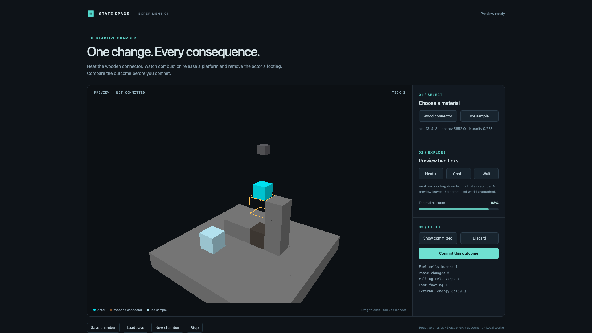

# Reactive chamber: native macOS acceptance

Implementation commit: `b9c15cb6cff52387a9d98490315ae733f474c1f8`. The source hashes in the
[raw report](reactive-chamber-20261019/report.json) were checked against the local
implementation after the final SDK rebuild. The [evidence index](reactive-chamber-20261019/evidence.json)
binds the report, screenshot and retained local supervisor receipt by SHA-256.

## Result

The 8³ CPU reactive chamber passed the fixed `chamber-visible` stage in Chrome
155 on native Apple Metal 3. Physics ran in a real dedicated browser Worker;
WebGPU rendered the complete reactive terrain, actor and selection. There were
no browser console errors, exact energy drift was zero, and cleanup completed.

| Measurement | Result | Acceptance target |
| --- | ---: | ---: |
| Two-tick preview p95, 12 samples | 18.1 ms | ≤250 ms |
| Cancellation acknowledgement p95, 12 samples | 1.3 ms | ≤100 ms |
| RAF worst gap during previews | 17.8 ms | <100 ms |
| Camera render p95, 120 measured frames | 1.5 ms | — |
| Worst completed camera render | 1.8 ms | ≤16.667 ms |
| Worst application render, including state changes | 4.0 ms | observed |

The offscreen camera test used 640×400 targets, ten warm-up frames after its
initial pixel/depth frame, and 120 measured frames. The real application rendered
30 additional frames at its capped canvas size. Camera timings include
encoding, submission and GPU completion; they are not simulation tick timings.

## Executed behavior

- Heating the wooden connector causes actual fuel consumption, bond retirement,
  platform settlement and actor loss of footing; cold and untouched controls
  remain standing. Heating the ice sample changes phase.
- Direct CPU and real Worker states match completely at preview and commit
  boundaries. Actor displacement and kinematic cadence are included.
- DOM preview/compare/discard/commit controls work; rapid requests retain only the
  latest intent. Cancellation waits for acknowledgement and spends nothing.
- The file-input load path restores through a fresh private Worker. Every
  recorded boundary and the final state match exactly, including the next
  preview/commit after restart. Corrupt history leaves the old chamber intact.
- A deliberately dropped commit acknowledgement fails closed as uncertain,
  preserves the last acknowledged save and sends no retry.
- Closing an active preview and stopping during startup release their resources.
  The renderer rejects overlapping frames and drains a pending frame on close.
- Native color/depth readback contains terrain and actor pixels, correct clear
  depth and a visible actor face in front of its projected center.

## Review and regression checks

Review found and corrected the initial actor-size scale assumption, startup/stop
races, externally mutable initial-save exposure, and endpoint failure cleanup.
The actor now uses the SDK's 1,024 Q/cell geometry scale; causal, picking and real
browser checks passed after correction. No unresolved blocking finding remains.

The final implementation passed 1,815 Vitest tests and 18 Node controller tests,
46 smoke tests and 13 smoke/transport tests, 64 supervisor tests (four existing
platform/containment cases skipped), two archive tests, and installed Python/npm
package checks with all 13 npm entry points. SDK/browser builds, TypeScript,
structural lint and changed Python lint passed. CI is tracked on the PR.

## Scope

This qualifies one 8³ reference chamber with one actor on the tested host. It is
not GPU reactive physics, 16³ qualification, cross-platform acceptance, or a
whole-product release gate. M5 schemas and kernels are unchanged. The next size
increase needs its own causal, responsiveness and rendering measurements.

See the [application contract and run instructions](../../examples/reactive-chamber/README.md).
