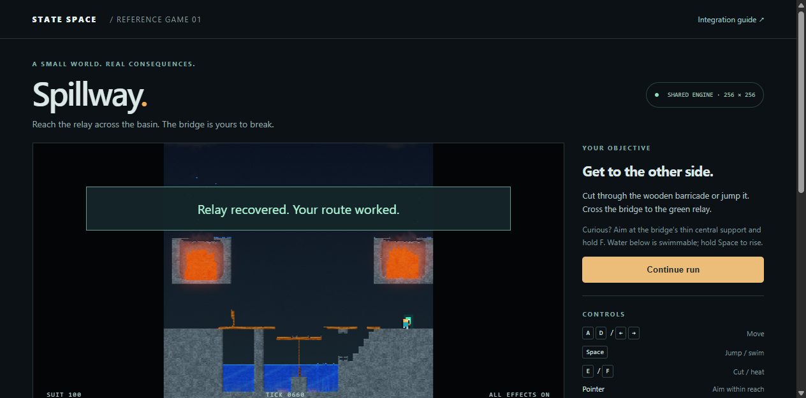

# Spillway reference game

Implemented and first measured October 12, 2026; the latest completed measurement
is October 13, 2026 (America/Los_Angeles).

The playable reference is [examples/spillway](../../examples/spillway/README.md),
served at <http://localhost:8765/examples/spillway/>. It uses the actual shared
engine for every material tick. Engine rules, material definitions and generated
physics assets are unchanged. The latest fix optimizes public single-cell edits
in the shared CPU/WebGPU field implementation while preserving their exact state.

**The latest full benchmark passes the strict 60 Hz gate on both routes, with
zero deadline misses across 1,200 measured frames and exact CPU replay.** GPU
utilization was 2% before measurement and 3% afterward. The same 256 × 256 field,
1920 × 1080 output, all effects and deadline criteria were used. The run completed
without another reported freeze. The runner flushes a
[progress journal](spillway/frames-spike-fix/progress.jsonl) to disk outside the
game loop so interrupted attempts retain their last observed status and tick.

## Collapse spike and fix

The prior quiet-machine run missed two deadlines. Its initiating spike was tick
205: cutting ten solid cells beside gas forced the game's selective editing
path. Each `setCell` call normalized all 65,536 cells, so ten edits repeated the
same global scan. That frame spent 23.9 ms in game/physics; its late completion
also delayed the following frame.

Replacing a cell with a noncohesive material now clears only its four neighboring
reciprocal bond flags. The field already holds complete validated structure with
no pending welds, so every distant bond, pin, integrity value and pressure word
is unchanged. Cohesive replacements retain the original normalization path.
Energy seeding, external-energy accounting, input validation and GPU invalidation
are unchanged. No physics passes or commands are skipped or moved out of timing.

The [before profile](spillway/spike-before.json) and
[after profile](spillway/spike-after.json) replay the same archived collapse
commands on CPU. The ten `setCell` calls at tick 205 fell from 15.27 ms to 0.11 ms;
the complete tool call fell from 15.50 ms to 0.26 ms. Both reproduce the original
660-tick digest and zero energy drift. These figures attribute CPU edit cost;
the full browser benchmark below measures GPU physics and the entire frame.
In that benchmark tick 205's game/physics phase fell from 23.9 ms to 4.2 ms and
callback-to-completion delay from 27.5 ms to 7.6 ms.

A direct [comparison with the pre-fix SDK](spillway/spike-edit-parity.json) also
matched all 432 complete states and energy ledgers before and after a tick:
every built-in replacement material at corners, edges and centers of fractured,
pinned, thin and pressurized fields. Both new benchmark routes retain exactly
the same commands and final digests as their pre-fix recordings. The raw frame
rows now include their ending tick for direct attribution.

```powershell
node scripts/profile_spillway.mjs docs/checkpoints/spillway/frames-retry/frames.json collapse <profile-output.json>
```

## Interrupted attempt

An earlier October 13 attempt reached the crossing route before the user
reported a computer freeze. Windows recorded an
unexpected reboot (Kernel-Power 41, bugcheck code 0, and EventLog 6008). Only the
initial screenshot survived; no completed timing or replay receipt was saved.
No display-driver reset, NVIDIA driver, WHEA or resource-exhaustion event was
returned in the examined three-hour log window. The cause remains undetermined;
that interrupted attempt supplies no performance or determinism result. Its
process was no longer running after the reboot. A new run was started only after
the user requested another attempt. See the
[interruption evidence](spillway/frames-quiet/interruption.json).

## Delivered behavior

- A complete small level: cross a basin, negotiate a wooden barricade, reach the
  relay, or destroy the central support and recover through the water.
- Integer sub-cell character motion, swept terrain collision, two-cell stepping,
  jumping, swimming, heat damage and deterministic escape/crushing handling when
  the shared engine moves material into the character.
- Cut and heat commands use public SDK edits. Heating adds a finite spark and
  heats nearby wood; ordinary engine combustion and structural failure do the
  rest. Edits remain in the external-energy ledger.
- Tick-stamped gameplay events consumed by the UI: collision, jumping, landing,
  cutting, heating, collapse, swimming, damage and relay recovery.
- Play/pause, single tick, complete restart, keyboard/touch controls, pointer
  aiming, replay, replay-file export and import.
- Exact replay includes initial state, normalized tick commands, all three
  physical arrays, absolute tick, engine/catalog identity, character motion and
  cooldowns, game flags, ordered events and energy accounting.
- An optional rectangle-sprite layer in the shared browser renderer. Character
  and relay drawing share the material renderer's GPU completion boundary.
- A built-in benchmark of the actual live game loop and a command-line runner
  that retains source hashes, raw timing, command recordings and CPU comparisons.

The actor is a kinematic game object: it collides with materials but does not
apply reciprocal forces or mass to the material field. Collapse detection is a
level-specific region rule; these gameplay events are an example integration,
not a new generic SDK event bus. Recordings are limited to 7,200 ticks and pin
this game version and initial scene. These boundaries are documented in the
integration guide.

## Runtime evidence

No tests were added. After the edit optimization, all 79 existing checks passed:
60 engine tests, 14 web/demo tests and 5 lab tests. Type checking,
TypeScript/engine lint and syntax checks also passed. Retained logs are
[engine and web](spillway/spike-existing-tests.log) and
[lab](spillway/spike-existing-lab.log). The earlier implementation verification
also passed nine native rendering tests; render shaders are unchanged.

The in-app browser was exercised with real keyboard controls: walking stopped
at the barricade, cutting opened it, and movement continued. A 98-tick run was
replayed in the UI, exported, imported and replayed again with an exact match.
Single-step advanced tick 98 to 99 while paused. The exported
[keyboard recording](spillway/keyboard-replay.json) was also run through the CPU
backend: [matching digest and event history](spillway/keyboard-cpu.json).

Both full benchmark routes reached the relay. The destructive route included
heat application, bridge collapse, water entry, swimming and water exit. Both
660-tick GPU runs reproduced exactly on the independent CPU physics backend,
including game state and events, with zero energy drift on both backends.
The three completed full benchmark attempts retain six exact 660-tick
cross-backend comparisons. Together with the keyboard recording this gives seven
comparisons covering 4,058 ticks. The original keyboard recording was also
[replayed again after the fix](spillway/spike-keyboard-cpu.json): its original
digest still matches, with zero energy drift.

The rebuilt SDK bundle SHA-256 is
`0862c671ccb7d051697b47bd62760e36e04402b232035006f8935744d790a4eb`.
The original bundle was
`a287960647bea48ebd90fbccd02b5787df73edc4abf6268a25547ae5b75683bc`.
Catalog identity and engine/game rules versions are unchanged. The latest
benchmark source hashes matched the working sources after measurement.

## Full-frame timing

RTX 4090, driver 595.79, i9-11900K; hardware WebGPU; 256 × 256 material field;
1920 × 1080 output; every material effect plus game sprites enabled.
Each route has 60 warmup callbacks followed by 600 measured callbacks. Warmup
frames, including early barricade cuts, are retained separately. Physics keeps
advancing after the relay is reached; character movement stops at victory.

| Route | Frame work p95 | Worst callback → GPU completion | Callback Hz | Deadline misses | Strict 60 Hz |
| --- | ---: | ---: | ---: | ---: | --- |
| Crossing | 11.8 ms | 13.5 ms | 59.952 | 0 / 600 | Pass |
| Support destruction / water recovery | 11.0 ms | 13.2 ms | 59.950 | 0 / 600 | Pass |

Both routes recorded zero missed display slots and zero coalesced callbacks.
Startup-frame maxima were 18.9 ms and 11.3 ms. No browser errors were reported;
source hashes matched after measurement. Exact replay and both energy ledgers
passed. The latest [raw benchmark receipt](spillway/frames-spike-fix/frames.json)
retains all measured and warmup frames.

The [pre-fix quiet-machine receipt](spillway/frames-retry/frames.json) is retained
with its two destructive-route misses and 27.5 ms worst completion delay. That
following frame began 11.0 ms after its callback and missed its deadline despite
taking only 9.9 ms of work. Crossing passed in that attempt.

The earlier [loaded-machine receipt](spillway/frames/frames.json) is preserved:
crossing recorded 61 misses and destruction 13, with frame-work p95 values of
17.2 ms and 14.6 ms. GPU utilization was 50% before that measurement and 45%
afterward, with NBA 2K26 running. Those readings identify competing load but do
not prove the cause of each missed deadline. The interrupted attempt is retained
separately and is not counted as a timing result.

Timing includes input, edits, shared physics and readbacks, character collision,
events, command recording, HUD updates, every material effect, sprites and GPU
completion. Startup compilation, hashing, CPU reference replay and OS scanout
are excluded. CPU replay runs between timed routes, never inside their frames.

```powershell
uv run python -m scripts.benchmark_spillway --browser-cli <agent-browser-cli> --output <new-evidence-directory> --require-locked
```


