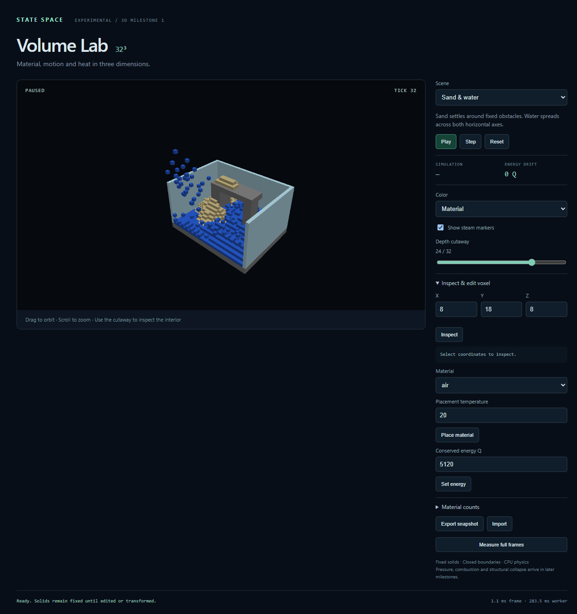

# Volume Lab

Build with `npm ci` and `npm run build:sdk`, serve the repository over localhost,
and open `/examples/volume-lab/`. The viewer needs WebGPU; physics runs entirely
in a CPU worker. The experimental SDK also runs without a GPU in Node.

```js
import { createStateSpaceField3D, MAT } from 'state-space-engine/experimental/3d';

const field = createStateSpaceField3D(32, 32, 32);
field.setCell(10, 3, 10, MAT.SAND);
field.step(1);
const saved = field.snapshot();
field.step(10);
field.restore(saved); // Exact physics continuation; resets energy-accounting baseline.
console.log(field.sample(10, 4, 10), field.energyBalance());
```

Drag to orbit and scroll to zoom. Use the Z cutaway to see behind the opaque
diagnostic walls and water. Steam is drawn as small markers. Material and
temperature coloring are presentation only; the display temperature clamps to
0–255 while inspection exposes the full energy-derived temperature.

Scenes start paused. Use Step, Play, Reset, or coordinate-based edits. Solids
stay fixed, including newly frozen ice. Lava and molten glass flow; molten
material becomes fixed when it solidifies. Hot and cold sources are finite.
There is no pressure, combustion, cohesive collapse or character controller.

Export/import saves complete versioned physics state. Invalid imports preserve
the current field. The importer accepts up to 4 MiB. Physics and rendering are
serialized with bounded work; slow frames reduce achieved simulation rate.
Worker or GPU failure pauses playback and retains the last committed state,
which remains exportable. Reload the page to recover the worker/device.

`window.volumeLab` exposes asynchronous `scene`, `step`, `snapshot`, `restore`,
`sample`, `setCell`, `setEnergy`, `renderOptions`, `hash` and `runBenchmark`, plus
`balance`, `cancelBenchmark` and `exportSnapshot`. Concurrent mutating requests
are rejected rather than queued. Rendering options never alter the field.

The measurement button runs all three scenes sequentially, with 60 warmup and
600 measured frames per scene at 1920×1080. The receipt includes worker
turnaround, copies, meshing, uploads, HUD work and GPU completion. Cancellation
retains a partial receipt. Timing is diagnostic; 60 Hz is not a release gate.

See [the M1 contract and retained evidence](../../docs/checkpoints/3D_M1.md)
for exact rules, reproduction commands and measured results.


